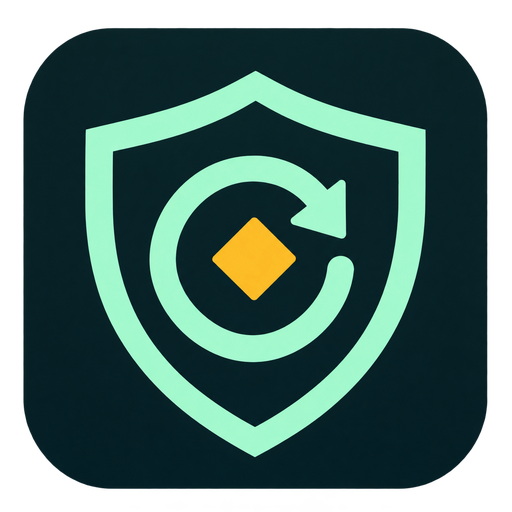
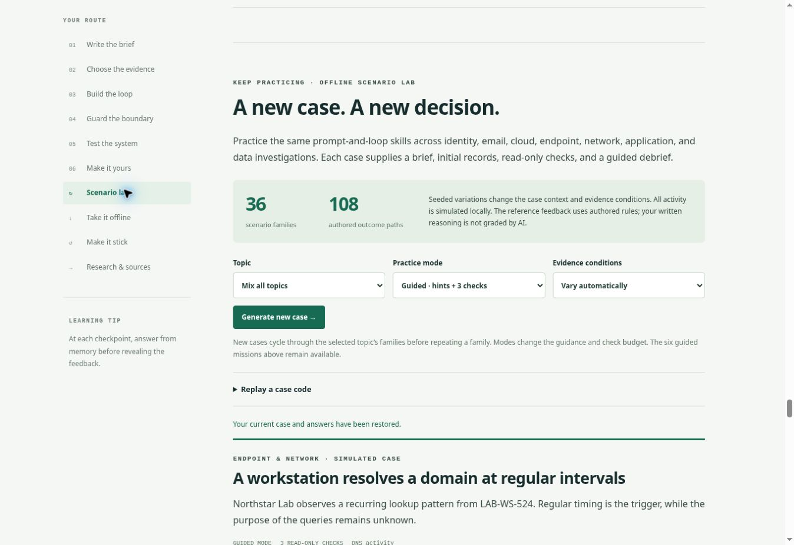

# CyberAI Master for PC

A visual, interactive field guide to AI prompt engineering and controlled investigation loops. The entire lesson and scenario generator run locally in one HTML file, with no hosting costs or AI API charges.

## Start on Windows — no installation needed

1. On this GitHub page, select **Code → Download ZIP**.
2. Extract the downloaded ZIP to a folder on your PC.
3. Double-click **`Create_Desktop_Shortcut.cmd`** to add the custom **CyberAI Master** icon to your Windows Desktop.
4. Open the new desktop icon, then choose **Scenario lab → Generate new case**.

You can also open **`Cybersecurity_AI_Lab.html`** or **`Open_Lab.cmd`** directly. Use a current desktop browser such as Chrome, Edge, or Firefox. If Windows opens the HTML in a text editor, right-click it and choose **Open with** your browser.

You can also download just [Cybersecurity_AI_Lab.html](Cybersecurity_AI_Lab.html) using GitHub's **Download raw file** control, or download the compact [offline package](Cybersecurity_AI_Lab_Offline.zip). The HTML works by itself. No Python, Node.js, account, API key, or internet connection is needed for the exercises.

## Your desktop icon

The complete package includes the logo as a PNG and a Windows ICO in `assets/`. The shortcut creator uses Windows' built-in PowerShell and shortcut support. It requires no administrator access or execution-policy change and finds your actual Desktop folder, including a redirected Desktop.

Keep the extracted folder and `assets/` in place so the shortcut can find both the lab and its icon. Run the shortcut creator again after moving the folder. It updates a shortcut only when it already targets this copy of the HTML; otherwise it creates an unused numbered name. The plain HTML file keeps its usual Windows file-type icon; the created **CyberAI Master** desktop shortcut displays the custom logo.

## What's inside

| Feature | Included |
| --- | --- |
| Visual lessons | Six missions and three interactive diagrams |
| Desktop identity | Embedded app logo, browser icon, and custom Windows desktop shortcut |
| Reusable investigations | 36 scenario families and 108 authored outcome paths |
| Topics | Identity and access; email and collaboration; cloud and DevOps; endpoint and network; application and data |
| Practice modes | Guided, Standard, and Advanced |
| Evidence conditions | Complete lookups, missing telemetry, stale data, conflicting records, timeouts, and hidden instructions |
| Learning sequence | Observe → Predict → Check → Explain |
| Sharing a case | Replay codes recreate the same scenario in the same edition |
| Keeping your work | Recent cases, local notes, export/import backups, and printable case sheets |

New cases cycle through the selected topic's families before repeating a family. Seeded variations change the details and evidence conditions. Each family has lower-concern, suspicious, and unresolved branches.

All evidence and tool actions are simulated. Buttons reveal authored records without contacting real systems. The guided feedback checks the selected assessment against the exercise's rules; it does not use a live AI model or grade free-form writing. The source research links remain in the lesson and need internet access when followed.



## Share with a friend

Send your friend the GitHub repository link, the HTML file, or the offline ZIP. This repository is currently private, so a friend needs repository access to use the GitHub link. You can share the downloaded HTML or ZIP directly. Each person opens their own copy on their PC. Use **Copy case code** and **Replay a case code** to compare the same case. Case codes do not contain your written answers.

## Save notes and progress

The page keeps the last 50 cases and your notes in browser storage when available. Use **Take it offline → Export notes & progress** to save a JSON backup; **Import a backup** restores it.

Export before moving or renaming the HTML, clearing browser data, changing browsers, or changing local server ports. Browser storage behavior varies for local files. A backup contains your typed answers, so share it only when you intend to share those notes.

## Optional: start a local server

Opening the HTML directly is the easiest option. If you prefer a localhost address and already have **Python 3**, open a terminal in the extracted folder and run:

```powershell
py Start_Local_Server.py
```

The launcher binds to `127.0.0.1`, asks the operating system for a free port, and opens the lab in your browser. Keep the terminal open while using it; press **Ctrl+C** to stop. It uses Python's standard library and does not create a public internet address. A different port on restart can give the page a different browser storage area; export your notes before stopping.

## Editing and rebuilding

The ready-to-open HTML is at the repository root. Editable lesson fragments, scenario catalogs, and diagram code are in `src/`; JavaScript and styles are in `dist/`.

With Python 3, rebuild the standalone HTML, offline ZIP, and launchers:

```powershell
py build.py
```

The build uses only the Python standard library and checks that the resulting HTML has no external runtime dependencies. It recreates the root deliverables and intermediate files in `dist/`.

If Node.js is installed, the optional engine verification checks 1,944 branch/mode/condition combinations, replay determinism, evidence visibility, call budgets, policy gates, timeouts, and state validation:

```powershell
node src/verify-engine.mjs
```

No build step is needed to use or share the included HTML.
